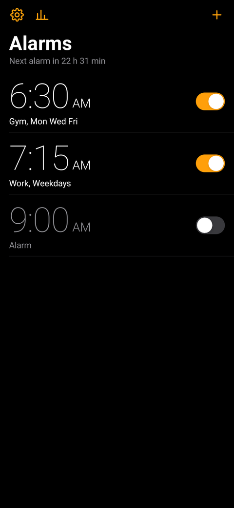
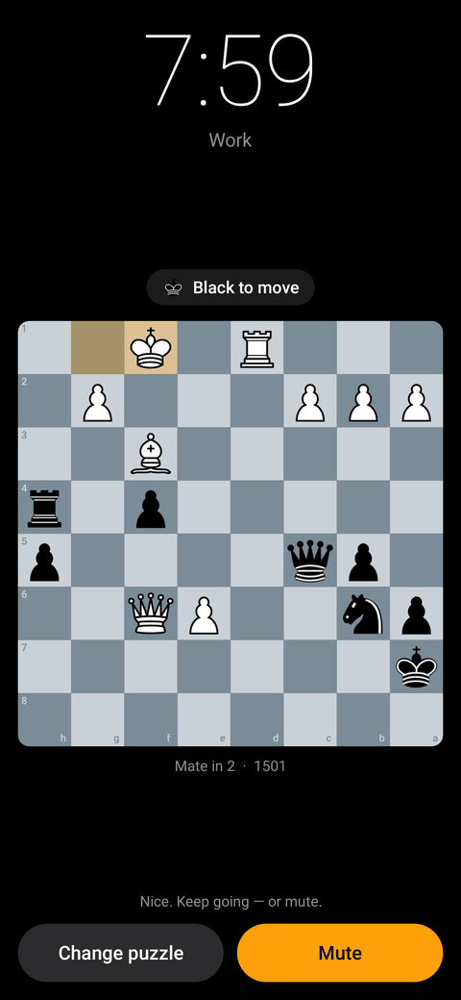
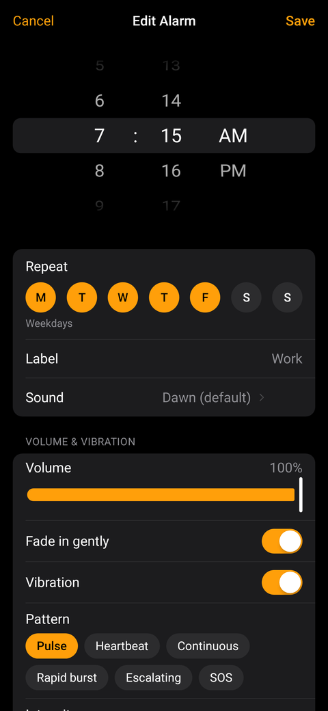
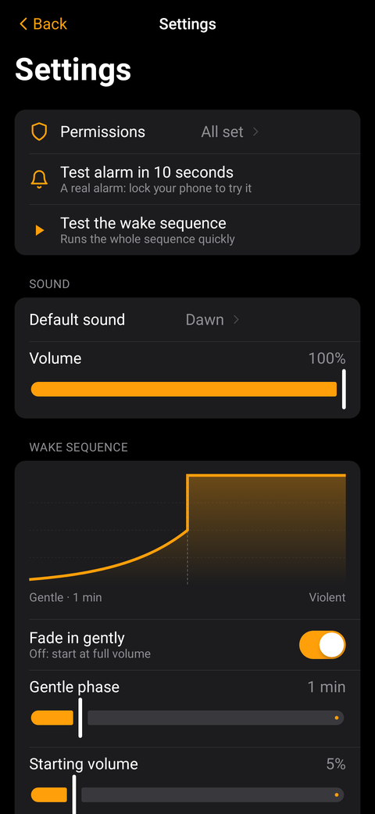

<div align="center">

# ♞ Chess Alarm

**The alarm clock you can't sleep through.**
It keeps ringing until you solve a chess puzzle, which proves you're actually awake.

[](https://github.com/m-aksymilian/chess-alarm/releases/latest/download/chess-alarm.apk)

[](https://github.com/m-aksymilian/chess-alarm/releases/latest)
[](https://github.com/m-aksymilian/chess-alarm/actions/workflows/build.yml)


<br>

&nbsp;
&nbsp;
&nbsp;


</div>

---

## Why

You switch off normal alarms half asleep, out of muscle memory, usually with the power button.
Chess Alarm takes that away. The power button, the volume keys and the back button do nothing. Leaving the
screen just brings it back. Even rebooting the phone doesn't help. **The only way out is to finish the puzzle.**

## Install

1. On your Android phone, tap **[Download APK](https://github.com/m-aksymilian/chess-alarm/releases/latest/download/chess-alarm.apk)**.
2. Open the downloaded `chess-alarm.apk`. If asked, allow your browser or Files app to *install unknown apps*, then tap **Install**.
3. Open Chess Alarm and tap **Allow** on each item of the welcome screen.
4. Go to **Settings › Test alarm in 10 seconds**, lock your phone and wait for it to ring.

New versions install over the old one and keep your alarms. Every version is listed on the
[Releases](https://github.com/m-aksymilian/chess-alarm/releases) page.

<details>
<summary><b>Why does it need these permissions?</b></summary>

| Permission | Why |
| --- | --- |
| Notifications | Shows the alarm over the lock screen. |
| Alarms & reminders | Rings at the exact minute, even in Doze. |
| Full-screen alarm | Opens the ringing screen and turns the screen on. |
| Unrestricted battery | Stops the system from delaying or killing the alarm. |
| Display over other apps | Brings the ringing screen straight back if you leave it. |
| Do Not Disturb access *(optional)* | Rings even if your Do Not Disturb settings silence alarms. |

On Samsung, Xiaomi, Huawei and OnePlus phones, also allow *Autostart* / *No restrictions* for Chess Alarm
in the battery settings. The only internet access is for the optional Spotify features.
</details>

## How it wakes you

```
 volume
   ▲                    ┌──────────── violent: 100%, strongest vibration, escalating
   │                 ╱╱ │
   │             ╱╱╱    │      touch the board ──► solving: vibration only
   │      ╱╱╱╱╱         │      stop for 20 s or press power ──► back to violent
   │ ╱╱╱╱╱  gentle      │      first correct move ──► Mute unlocks
   └────────────────────┴──────────────────────────────────────────► time
                      60 s                       solve the line ──► ✓ silence
```

1. **Gentle:** starts barely audible and rises on a smooth curve.
2. **Violent:** full volume, the Violent or Maximum vibration preset, getting stronger every 30 s. An optional harsher second sound can take over here.
3. **Solving:** as soon as you touch the board, it switches to vibration only (or low sound, or no change; your choice).
4. **Inactivity guard:** stop playing for 20 s, or turn the screen off, and it goes straight back to full blast.
5. **Solved:** play the whole line and it goes quiet with a little celebration.

Every stage is adjustable, globally and per alarm, and *Settings › Test the wake sequence* runs the whole thing sped up.

## Features

**⏰ A proper alarm clock**
- Multiple alarms with label, repeat days, sound, vibration and volume
- iOS-style wheel time picker, swipe to delete, "Next alarm in 7 h 12 min"
- Exact timing that shows in the status bar and survives Doze, reboots, app updates and time-zone changes
- Rings at alarm volume through silent mode and Do Not Disturb. No snooze, by design.

**♟️ Puzzles**
- 1,000 short [Lichess](https://lichess.org) puzzles: mate in 1, mate in 2 and two-move tactics, rated 1200–1900
- Full chess rules (castling, en passant, promotion picker), drag or tap to move, legal-move dots
- Wrong moves snap back with a shake; the opponent's replies animate in
- Any checkmate counts. "Change puzzle" whenever you're stuck. Adjustable difficulty range.

**🔊 Sounds**
- 8 original tunes, from gentle to harsh
- Your phone's alarm sounds and ringtones, or any audio file
- **Spotify:** a song, album or playlist (with shuffle), falling back to a built-in tune if Spotify doesn't start
- **From a video:** pull the audio out of an MP4, choose the start point, preview it

**📳 Vibration**
- Pulse, heartbeat, continuous, rapid burst, escalating and SOS patterns
- Five intensities, from Gentle to Maximum, with smart escalation

**✨ Extras** (each one is a toggle)
- **Are you still awake?** A few minutes after solving, tap "I'm up", or it rings again: vibration first, then a fade into full blast. Every part is adjustable.
- **Adaptive difficulty:** a bit harder after quick solves, easier after slow ones
- **Wake-up stats:** streak, best streak, average time to solve
- **Bedtime reminder**, based on your next alarm
- **Emergency exit:** hold the clock for 3 s and type a long code. It's logged in your stats.
- **Escape prevention:** warns you at bedtime after a force-stop, and asks for a puzzle before you change an alarm in its last 10 minutes
- **Home screen widget:** the next alarm with an on/off switch

## Spotify (optional)

Spotify needs Premium and a free developer app of your own:

1. Create an app at [developer.spotify.com](https://developer.spotify.com/dashboard) and tick **Android** and **Web API**.
2. Register these:
   | Field | Value |
   | --- | --- |
   | Redirect URI | `chessalarm://spotify-callback` |
   | Android package | `app.chessalarm` |
   | SHA-1 fingerprint | `CB:DE:8D:DC:EB:B0:A1:01:73:6F:84:30:34:8A:5B:81:2C:7E:48:AF` |
3. Under **User Management**, add your Spotify account.
4. In Chess Alarm, open **Settings › Spotify**, paste the client ID and tap **Log in**.

## Build it yourself

```bash
./gradlew :app:testDebugUnitTest     # chess rules (perft), puzzle logic, alarm state machine, time maths
./gradlew :app:assembleRelease       # signed release APK → app/build/outputs/apk/release/
./gradlew :app:testDebugUnitTest -Pscreenshots --tests '*ScreenshotTest*'   # renders screens to app/build/screenshots
```

You need JDK 17+ and the Android SDK (platform 37.2). Every push runs the tests in GitHub Actions and builds a
signed APK, and pushes to the default branch are published as a release.

<details>
<summary><b>About signing</b></summary>

The release key is committed in `app/signing/`, so builds need no secrets. Because this repository is public,
that also means **anyone could sign an APK that Android would accept as an update to Chess Alarm. Only install
builds from this repository's [Releases](https://github.com/m-aksymilian/chess-alarm/releases) page.**

To close that gap, sign with a new key from repository secrets: `KEYSTORE_PATH` (from a decoded
`KEYSTORE_BASE64`), `KEYSTORE_PASSWORD`, `KEY_ALIAS` and `KEY_PASSWORD`. Existing installs would then need one
reinstall. The optional `SPOTIFY_CLIENT_ID` secret builds your client ID into the app.
</details>

## Credits

- **Puzzles:** [Lichess puzzle database](https://database.lichess.org/#puzzles), CC0. Picked by `tools/select_puzzles.py`.
- **Chess pieces:** the *cburnett* set by Colin M.L. Burnett (GPLv2+ / BSD / CC BY-SA 3.0), converted by `tools/svg_to_vector.py`.
- **Tunes and sound effects:** original, synthesised by `tools/make_sounds.py`.
- **Spotify App Remote and Auth SDKs:** © Spotify AB, Apache 2.0.
